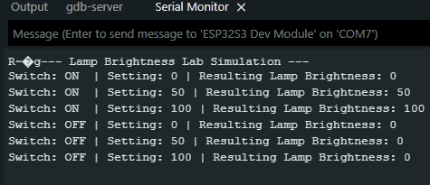

# Lamp Brightness Laboratory Activity

## Arduino Code Sketch
See the `sketch_nov14a.ino` file in this repository for the complete code.

## Test Results

## Explanation of Parameters & Return Value
- **`bool switchOn`**: Evaluates whether the power switch is active (`true` or `false`).
- **`int brightnessSetting`**: Holds the desired intensity value (0 to 100).
- **Return Value (`int`)**: Returns the target brightness if the switch is on, or overrides it to `0` if the switch is off.

## Coding Check Answers
1. **Data type, variable name, initial value:** `int` is the data type, `brightnessSetting` is the variable name, and `75` is the initial value. Change it to 50 by writing `brightnessSetting = 50;`.
2. **`bool` vs `int`:** `bool` fits `switchOn` because a switch has only two states (on/off). `int` fits `brightnessSetting` because it requires numeric gradient levels from 0 to 100.
3. **Prediction for setting 80, switch false:** The output will be `0` because the switch cuts power regardless of the slider value.
4. **`switchOn` vs `switchon`:** No, C++ is case-sensitive, so the capital `O` makes them entirely different variables.
5. **Values passed and returned:** It accepts a boolean and an integer, and returns an integer representing the resulting brightness level.
6. **Scope accessibility:** No, a variable declared inside `setup()` has local scope and cannot be accessed directly by `loop()`.
